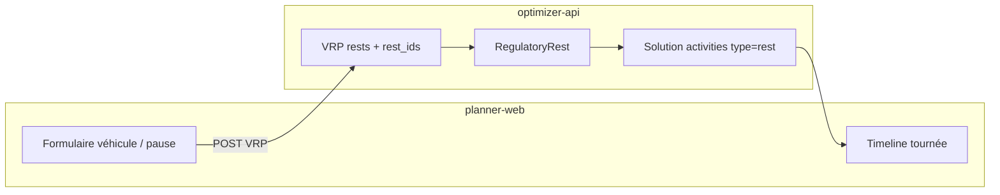

# Specs planner-web — pauses réglementaires

Document à transmettre tel quel à **planner-web**.

Côté optimizer-api, la feature est déjà implémentée (`rests[].lapse`, interpreter `RegulatoryRest`). Pas de nouvel endpoint.

Deux modes de pause coexistent :

- **Pause classique** : `duration` + `timewindows` (créneau horaire, 1 pause). Comportement historique.
- **Pause réglementaire** : `duration` + `lapse` (toutes les X heures de **travail**, répétable). Nouveau.

Ils sont **mutuellement exclusifs** (`timewindows` XOR `lapse`).



---

## 1. Contrat API (input)

### 1.1 Champ nouveau

Sur chaque objet de `vrp.rests[]` :

| Champ | Type | Unité | Obligatoire | Contraintes |
|---|---|---|---|---|
| `id` | string | — | oui | identifiant unique du rest |
| `duration` | integer ou `"H:MM:SS"` | secondes | oui si `lapse` | `> 0` et **strictement inférieur** à `lapse` |
| `lapse` | integer ou `"H:MM:SS"` | secondes | non | si présent : `> 0` ; **interdit** avec `timewindows` |
| `initial_offset` | integer ou `"H:MM:SS"` | secondes | non | défaut `0` ; travail déjà fait avant la tournée (avec `lapse` seulement) |
| `timewindows` | array (max 1) | — | non | mode classique uniquement |

Les durées acceptent les formats optimizer : `2700`, `"0:45:00"`, `"0:45"`.

### 1.2 Rattachement véhicule

Inchangé : `vehicles[].rest_ids: ["pause_reglementaire"]`.

Sans `rest_ids`, le rest est ignoré (pas d’erreur). **Il faut l’assigner à chaque véhicule** concerné.

### 1.3 Exemple request (45 min toutes les 6 h de travail)

```json
{
  "vrp": {
    "rests": [{
      "id": "pause_reglementaire",
      "duration": 2700,
      "lapse": 21600
    }],
    "vehicles": [{
      "id": "vehicle_0",
      "rest_ids": ["pause_reglementaire"],
      "timewindow": { "start": 28800, "end": 64800 }
    }]
  }
}
```

Équivalent lisible : `duration: "0:45:00"`, `lapse: "6:00:00"`.

### 1.4 Sémantique (à afficher / documenter dans l’UI)

- `lapse` = durée de **travail** (trajet + service + setup), **pas** l’attente chez le client.
- `rests[].initial_offset` (secondes, défaut 0) = travail déjà effectué avant le début de la tournée ; compte pour la **première** pause (celle-ci arrive plus tôt). Uniquement avec `lapse`.
- Au bout de `lapse` secondes de travail → pause de `duration`, **répétable** (2e pause après 2×`lapse`, etc.).
- Formule solver : chaque heure de mission/trajet est gonflée de `duration / lapse` (durées au supérieur). Les **ouvertures** de créneaux clients sont reculées du même ratio depuis le début de tournée, **plafonnées à `duration`** (une pause). Les **fermetures** et l’amplitude véhicule restent inchangées.
- Plusieurs pauses par tournée sont voulues et supportées.
- Les rests `lapse` ne sont **pas** envoyés aux solveurs et **ne skippent** aucun solveur (`assert_no_rest` ignore ces rests).
- **Indispo** : optimisation périodique / schedule (`first_solution_strategy` periodic, plage `configuration.schedule`).

### 1.5 Erreurs à gérer côté UI

| Condition | Erreur API |
|---|---|
| `lapse` et `timewindows` ensemble | validation Grape `mutually_exclusive` |
| `lapse` sans `duration` > 0 | `DiscordantProblemError`: *Rests with lapse require a strictly positive duration* |
| `duration >= lapse` | `DiscordantProblemError`: *Rest duration must be smaller than lapse* |
| plusieurs rests `lapse` avec des ratios `duration/lapse` différents | `UnsupportedProblemError`: *Regulatory rests must share the same duration/lapse ratio* |
| pause réglementaire + planning périodique | `UnsupportedProblemError`: *Rests are not available with periodic heuristic* |

Recommandation UI : un seul couple `(durée pause, lapse)` **par optimisation** (tous les véhicules partagent le même ratio). Varier uniquement l’activation par véhicule (`rest_ids`), pas les durées.

---

## 2. Contrat API (output)

Les pauses réinsérées sont des **activités de tournée** existantes :

- `type`: `"rest"` (libellé FR export : `pause`)
- `rest_id`: id d’origine du rest (ex. `"pause_reglementaire"`)
- `detail.duration`: durée de la pause (secondes)
- `begin_time` / `end_time` / `departure_time`: horodatage de la pause
- `travel_time` / `waiting_time`: 0 sur l’arrêt pause

**Point d’attention UI** : plusieurs pauses d’une même règle partagent le **même** `rest_id` (et souvent le même `id`). Ne pas keyer les stops d’une tournée par `rest_id`. Afficher **chaque** activity `type=rest` dans l’ordre de `activities[]`.

Exemple de séquence :

```text
depot → service → rest → service → rest → service → rest → depot
```

Les totaux de tournée (`total_time`, `end_time`, …) **incluent** les pauses.

---

## 3. Ticket UI planner-web

### 3.1 User story

En tant que planificateur, je configure une pause réglementaire (durée Y toutes les X heures de travail) sur les véhicules, je lance l’optimisation, et je vois les pauses réellement insérées dans la timeline / la carte / l’export.

### 3.2 Saisie (véhicule ou réglage flotte)

Étendre l’écran pause existant avec un **type** :

1. **Créneau horaire** (classique) — champs actuels : durée + fenêtre.
2. **Pause réglementaire** (nouveau) — champs :
   - Durée de pause (time picker, défaut proposé : `0:45`)
   - Toutes les X heures de travail (time picker, défaut proposé : `6:00`)
   - Helper visible : « 45 min toutes les 6 h → environ 7 min 30 s de pause réservées par heure de tournée »

Règles UX :

- Masquer les timewindows si type réglementaire (et inversement).
- Valider `durée < lapse` avant envoi.
- Si plusieurs véhicules : même `(durée, lapse)` ; checkbox « appliquer à tous les véhicules du zonage / de la flotte ».
- Désactiver ou warning si le job est un planning périodique / multi-jours schedule.
- Libellés FR : utiliser l’espace insécable avant `:` (`Durée de pause :`, `Toutes les :`).

Payload à produire : un `rests[]` + `rest_ids` comme en §1.3. Pas de nouveau endpoint.

### 3.3 Restitution

- Timeline / Gantt : barre `pause` de `begin_time` → `end_time`, même style que les rests classiques.
- Liste d’arrêts : type `pause`, pas de client / pas d’adresse obligatoire (pas de `point_id`).
- Carte : pas de géométrie propre (l’arc reste entre les deux visites). Placement : voir §3.4.
- Plusieurs pauses possibles sur **une** tournée.
- Export CSV / PDF : déjà `type_rest: pause` ; une ligne par occurrence.

### 3.4 Hors scope / limites à assumer dans l’UI (ne pas « corriger » côté front)

- La pause est un saut discret alors que le solver a vu des durées gonflées en continu : un créneau juste après la pause peut encore être raté.
- Durées envoyées au solver : arrondi au **supérieur**. Ouvertures reculées (max = durée de pause) ; fermetures et amplitude véhicule inchangées.
- L’attente chez le client **ne compte pas** dans les X heures.
- Placement : **après** la visite si le `lapse` est atteint pendant le service ; **avant** le trajet si c’est le déplacement qui ferait l’atteindre, sauf créneau suivant trop serré. Jamais au milieu d’une visite.

### 3.5 Acceptance criteria

- [ ] Je peux créer une pause réglementaire 45 min / 6 h et la lier à un ou plusieurs véhicules.
- [ ] Je ne peux pas combiner créneau horaire et `lapse` sur la même pause.
- [ ] Le VRP envoyé à optimizer-api contient `rests[].lapse` + `vehicles[].rest_ids`.
- [ ] Après solve, la tournée affiche 0, 1 ou N pauses `type=rest` selon la durée de travail réelle.
- [ ] Deux pauses de la même règle s’affichent toutes les deux (pas d’écrasement par `rest_id`).
- [ ] Planning périodique : le champ est masqué ou une erreur claire est affichée.
- [ ] Tests UI happy path : tournée assez longue pour 2 pauses, les deux apparaissent dans la timeline.

### 3.6 Copy suggéré (FR)

- Titre : `Pause réglementaire`
- Champ (payload `lapse`) : `Toutes les`
- Suffixe : `heures de travail`
- Aide : `Le temps d’attente chez le client n’est pas compté. Plusieurs pauses peuvent être insérées sur une même tournée.`
